# COMP3041-GroupJ-Assignment1 [Reflective Proposal]

## Introduction

Selene is an Android menstrual/period cycle tracker built using Flutter and Dart, built and maintained by one of the members in Group J. It is distributed via signed GitHub Release APKs rather than a known application store such as Google Play Store, Apple Store, or F-Droid. Selene's primary function is to promote the access of reproductive health and facilitate access to broader care options, including medication interactions screenings while being designed with user privacy and data sensitivity in mind.

Users are able to log their menstrual flow, symptoms, chronic conditions, intimate activity, and fertility biomarkers and predictions on their upcoming menstruation date; they are also able to export PDF/CSV summaries of their logged data and check medicinal interactions across approximately 5,600 drugs logged by the Food & Drug Administration through one of their openFDA datasets.

Selene is aimed primarily towards privacy-conscious menstruating users, including but not limited to users in anti-abortion jurisdictions, patients with neuroendocrinological disorders (such as PMOS/PCOS, Endometriosis). Selene may be of interest to the aforementioned target audience due to the routine dissemination and marketing of user data (including Personally Identifiable Information) to data brokers by commercially available Period Tracking Applications (PTAs) (Zadushlivy et al., 2025).

## Involved Stakeholders

## Analysis of Ethical Issues using the SE Code of Ethics

### Issue 1: Protection of sensitive data on the device

<b>Claim.</b> Selene mostly aligns with clause 3.12 (“work to develop software … that respect[s] the privacy of those who will be affected”). We still only rate it as partially meeting the clause, because its strongest protection is switched off when the app is installed.

<b>Evidence.</b> The release build removes the internet permission (<code>AndroidManifest.xml</code>), and according to the README, a release cannot be built if the APK asks for network access. We checked the APK we actually installed to confirm this. It asks for notification, alarm, boot, biometric and vibration permissions, but not for internet or network access, and cloud backup is switched off (<code>allowBackup="false"</code>) (Appendix B). In Part 1 we described a plaintext SQLite database. That is no longer the case: the database is now encrypted, with the key kept in Android’s secure key store. When we tried to export a backup, the app first asked whether we wanted a passphrase, and “Protect and save” was the main button (Figure 1). Lock-screen notifications hide their content by default. The app lock (“Require unlock”) is off by default, though (Figure 2). This is the same app whose first screen calls intercourse records “the most sensitive thing Selene stores” (Figure 3).

<table align="center"><tr><td align="center" valign="top"><b>Figure 1</b> <i>Passphrase prompt shown when exporting a backup</i> 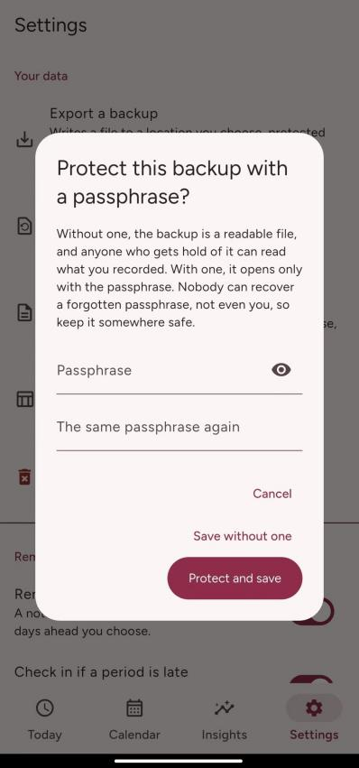</td><td align="center" valign="top"><b>Figure 2</b> <i>The "Require unlock" app lock, off by default</i> 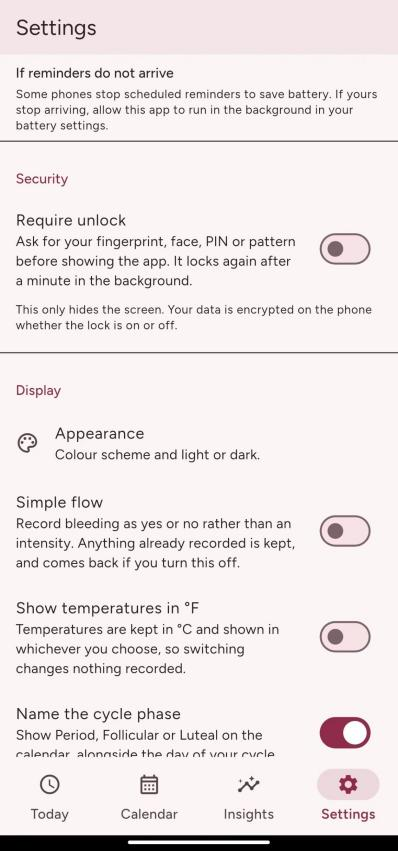</td><td align="center" valign="top"><b>Figure 3</b> <i>Onboarding notice on recording intercourse</i> 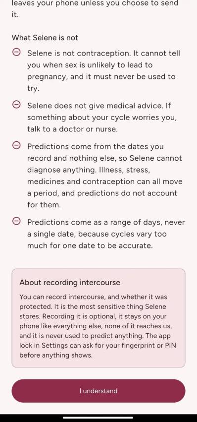</td></tr></table>

<b>Reasoning.</b> Clause 3.12 asks engineers to “work to develop” software that respects privacy, and moving from plaintext to encrypted storage is exactly that kind of work. We were also surprised by how open the in-app privacy statement is about its own limits. It says encryption “does not protect an unlocked phone” and that a forensic tool “may be able to use the key the way the app does” (Figure 4). That fits clause 1.04, which asks engineers to disclose “any actual or potential danger to the user”. The default is what holds the rating back. If the user never finds the lock setting, anyone holding the unlocked phone can open the app and read intimate and health records. Given the sensitivity of such records, the consequences of exposure could extend beyond ordinary data breaches and potentially place users at legal or personal risk. There is still no duress PIN or emergency wipe either. So the forensic risk from Part 1 has been explained to users, but it has not gone away.

<table align="center"><tr><td align="center" valign="top"><b>Figure 4</b> <i>In-app privacy statement on encryption and its limits</i> 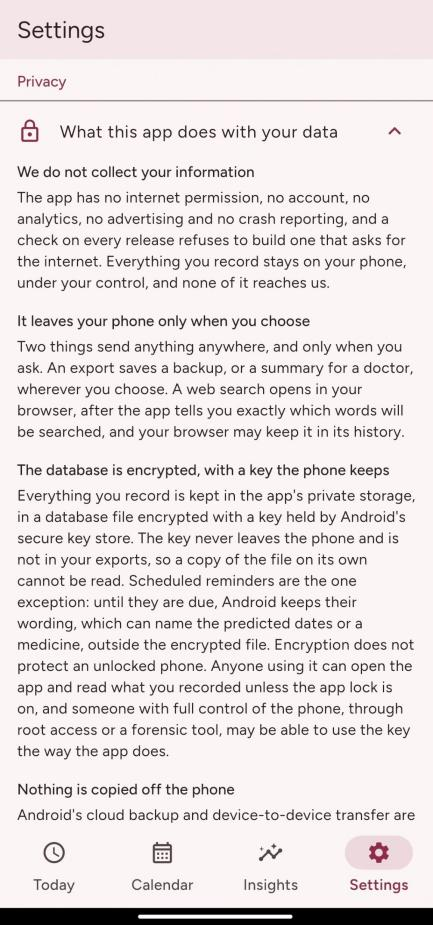</td></tr></table>

<b>Counterpoint.</b> Turning the lock on by default would only work on phones that already have a PIN or fingerprint set up, and it would get in the way for people who do not need it. The app also explains that the lock “only hides the screen”, so users are unlikely to mistake it for encryption. Leaving the choice to the user is a reasonable design decision. Implementing additional counter-forensic mechanisms, such as duress PINs or automatic data destruction, could introduce other risks, including accidental deletion of medically significant records or a false sense of security.

### Issue 2: Honesty about what the predictions can do

<b>Claim.</b> Selene aligns with clauses 1.06 and 6.07 in what it says about itself, and its predictions are as accurate as it claims for users with regular cycles. For users with irregular cycles it diverges from 6.07, because it describes their predictions with the same confidence even though they are right far less often.

<b>Evidence.</b> The first screen says Selene “is not contraception” and “does not give medical advice”. It also says predictions “come from the dates you record and nothing else”, so illness, stress and medicines are not taken into account (Figure 5). The temperature, mucus and progesterone fields are labelled “only a record”, and the app says it never uses them to estimate ovulation. An ovulation estimate exists, but it is off by default, with a note that it is “not accurate enough to plan or avoid pregnancy with” (Figure 6). To test the predictions, we entered a history of cycles ranging from 18 to 82 days. The app still gave a range 11 days wide and said “About four out of five times start in this range”. Further down the same Insights screen, it reported that “of your last 3 predictions, 0 were within 2 days” and that it “has been off by about 15 days on average” (Figure 7). One test history proves little on its own, so we also ran the backtesting tool that comes with Selene’s source code (Appendix A). It simulates 1,000 users with 18 cycles each and runs the same model as the app. For simulated users with regular cycles, 85.3% of periods started inside the window the app would have shown. For users with irregular cycles, only 47.7% did.

<table align="center"><tr><td align="center" valign="top"><b>Figure 5</b> <i>Onboarding screen listing what Selene is not</i> 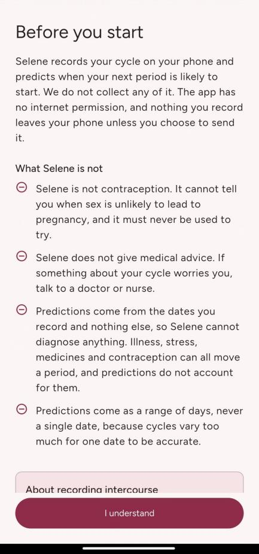</td><td align="center" valign="top"><b>Figure 6</b> <i>Display settings: phase labels on, ovulation estimate and Learn tab off</i> 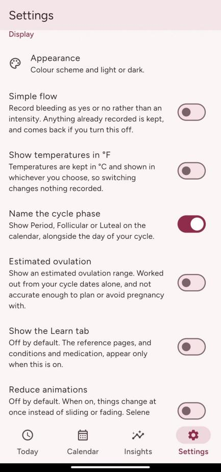</td></tr></table>

<table align="center"><tr><td align="center" valign="top"><b>Figure 7</b> <i>Insights after logging cycles of 18 to 82 days (left: prediction; right: track record)</i> 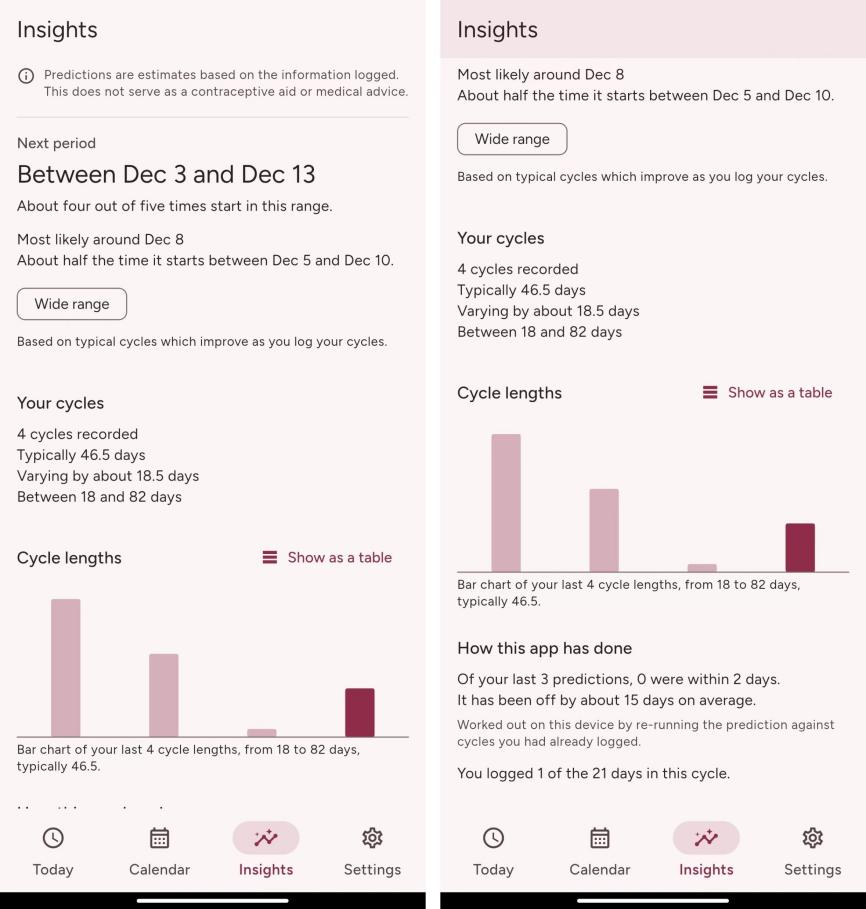</td></tr></table>

<b>Reasoning.</b> Clause 6.07 tells engineers to avoid claims that are “speculative … misleading, or doubtful”. On the whole, Selene’s disclaimers do this well. We have not seen many period trackers that show users their own error rate. It also answers part of our Part 1 criticism about biomarkers. The app still ignores them, but it now says so plainly. For regular users, the “four out of five” line is accurate, even slightly cautious. The problem is that irregular users see exactly the same sentence. According to the backtest, the window shown to them is right about half the time, so for them the sentence is misleading in the sense 6.07 describes. Our own test showed the same pattern on screen: an 11-day window next to an average error of 15 days. The cycle phases (“Follicular”, “Luteal”) are also shown by default, even though the app works them out from dates and has no way of observing them.

<b>Counterpoint.</b> The backtest uses simulated users rather than real ones, and “irregular” is the simulator’s own category, so the exact percentages should be read with caution. Accuracy also improves as users log more cycles. For irregular users with 13 or more cycles of history, 70.9% of periods fell inside the window, which is still short of 80% but much closer. The screen labels these predictions “Wide range” and shows the app’s own accuracy further down, so a careful user does have what they need to judge them. Users who want to can turn the phase labels off in Settings.

### Issue 3: Fairness to users with irregular or short cycles

<b>Claim.</b> In Part 1 we argued that Selene leaves irregular users behind. Our results are mixed. The app often withholds predictions from irregular users, but it does not abandon them, and we also found a separate problem with short cycles. We rate Selene as partially meeting clause 1.07.

<b>Evidence.</b> According to the code, the app stops predicting once its 80% window reaches 14 days or more (<code>priors_bundled.dart</code>). Our own test history, with cycles between 18 and 82 days, never reached this threshold. The backtest showed a different picture. For simulated users with irregular cycles, 63.7% of predictions would have been withheld, compared with 5.2% for users with regular cycles (Appendix A). When the threshold is reached, the app shows the user’s own figures with the message “Cycles that vary this much are worth showing a clinician”, and a comment in <code>intervals.dart</code> says this screen “must never be a dead end”. The short-cycle problem showed up by accident. One of the cycles we entered was 12 days long. We had logged four complete cycles, but the Insights screen said “3 cycles recorded” and gave no reason (Figure 8). The code explains why: any cycle under 15 days is marked “implausibly short” and left out of the predictions (<code>cycle_rules.dart</code>). The only place this is mentioned is the PDF summary for a doctor, which labels such cycles “Under 15 days”. Recording conditions like PMOS is also hidden, behind a “Learn” tab that is turned off by default (Figure 6).

<table align="center"><tr><td align="center" valign="top"><b>Figure 8</b> <i>Insights counting three cycles after four were logged</i> 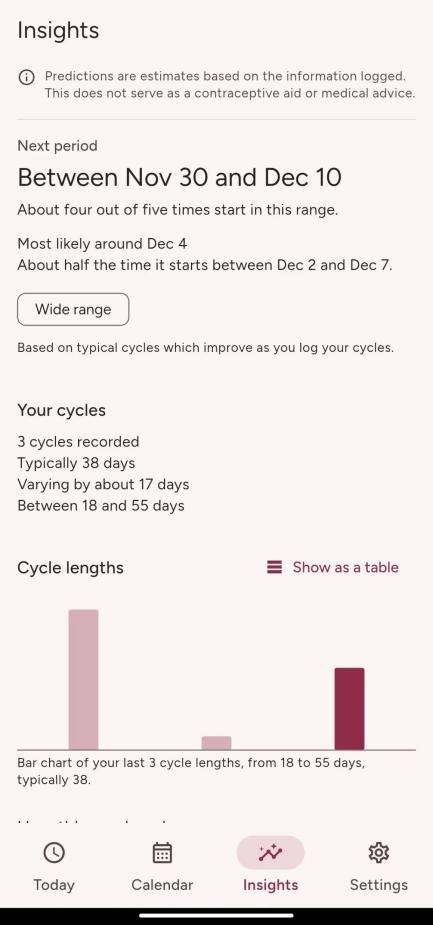</td></tr></table>

<b>Reasoning.</b> Clause 1.07 asks engineers to “consider … factors that can diminish access to the benefits of software”. Selene partly does this for irregular users. When it withholds a prediction, the user still gets their own figures and a suggestion to see a clinician, which is more useful than a guess. But in the simulation, irregular users went without a prediction about two times in three. So our Part 1 concern was partly right: the users whose cycles are hardest to plan around are the ones the app most often cannot help with predictions. Short cycles are a separate problem. Someone whose cycles really are that short, for example with polymenorrhoea, is quietly treated as if they made a mistake. Their predictions get less accurate and the app never tells them why. That also falls short of 6.07.

<b>Counterpoint.</b> Withholding a prediction is a defensible choice. The windows the app does show to irregular users are right only about half the time, so showing even wider ones would add little. The 15-day rule is there to stop spotting or mistaken entries from spoiling the predictions, and those are much more common than real 12-day cycles. The developer also wrote down the reasoning in the code. A short note on the Insights screen would fix the short-cycle problem without changing the rule.

### Issue 4: Accountability and redress for a single-maintainer health app

<b>Claim.</b> Selene’s testing mostly aligns with clause 3.10. How users report problems is another story: it diverges from clause 6.08 and partly from 3.12.

<b>Evidence.</b> The repository has a large test suite. It includes “golden vectors” that stop the build if the Dart and Python versions of the model disagree, and a check that refuses any release asking for a network permission. In the app itself, though, the About section shows nothing but a version number (Figure 9). The Privacy Policy gives public GitHub Issues as the only way to get in touch, and asks users not to post anything they have recorded. The code is released under the MIT licence, “as is” and without warranty. We also found a smaller problem by accident. When the app asked whether to turn on reminders, we chose “Not now”. Afterwards, both reminder switches in Settings were still on, but Android’s own settings showed notifications blocked for Selene (Figures 10 and 11). We confirmed this on a fresh install of the app. A user could easily think the “late period” reminder is active when it will never arrive.

<table align="center"><tr><td align="center" valign="top"><b>Figure 9</b> <i>About section, showing only the version number</i> 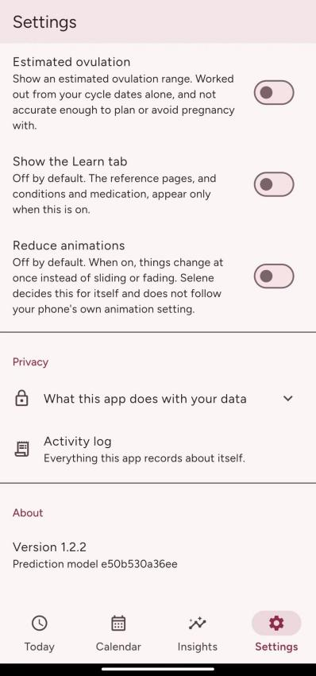</td><td align="center" valign="top"><b>Figure 10</b> <i>Reminder switches still on after choosing "Not now"</i> 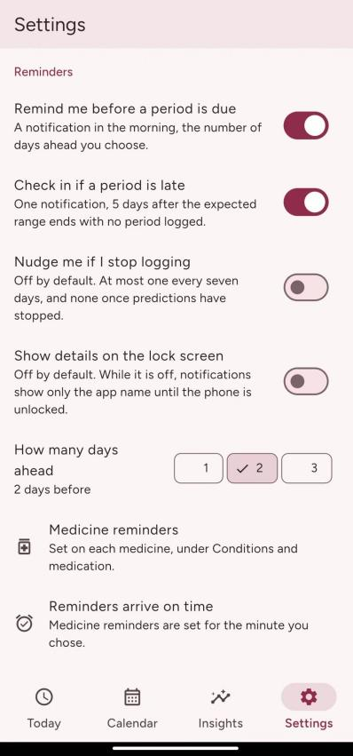</td><td align="center" valign="top"><b>Figure 11</b> <i>Android notification settings: notifications blocked for Selene</i> 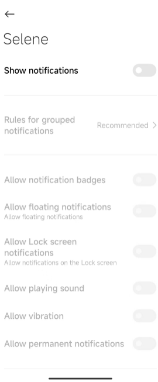</td></tr></table>

<b>Reasoning.</b> Clause 3.10 requires “adequate testing, debugging, and review”, and Selene’s automated checks go further than most student projects. However, the reminder issue shows that automated tests do not necessarily catch every inconsistency between the app’s interface and the behaviour of the operating system. A user may rely on a reminder that is not actually enabled, which shows why testing should also cover practical user interactions and system-level behaviour. Clause 6.08 asks engineers to “take responsibility for detecting, correcting, and reporting errors”. In practice, a lot of errors are only found when users report them. A public issue tracker is a bad fit for a menstrual and sexual health app. To explain a wrong prediction, a user might have to post health details where anyone can read them, which goes against 3.12. With no private way to report problems, users may simply not report them, which makes defects harder to detect and correct.

<b>Counterpoint.</b> Because the code is open, anyone can inspect it, and many commercial trackers offer nothing like that. A private contact channel would mean collecting email addresses or similar, which goes against the app’s whole no-collection design. The MIT licence is also the normal legal choice for open-source software. Using it does not show that the developer ignores ethical responsibility.

### Summary of judgements

| Issue | Clause | Judgement | Change from Part 1 |
|---|---|---|---|
| 1. Data on the device | 3.12 | Partially meets | Improved: database encrypted; no network permission in APK |
|  | 1.04 | Aligns | New: risks disclosed in-app |
| 2. Honesty of predictions | 1.06, 6.07 (disclaimers) | Aligns | New evidence |
|  | 6.07 (confidence wording) | Diverges for irregular users | New issue, confirmed by backtest |
| 3. Irregular and short cycles | 1.07 (irregular cycles) | Partially meets | Part 1 concern partly confirmed |
|  | 1.07, 6.07 (short cycles) | Partially meets | New issue |
| 4. Accountability and redress | 3.10 | Mostly aligns | New evidence |
|  | 6.08, 3.12 | Diverges | Confirmed |

### Where the Code does not settle the question

We ran into three tensions that the SE Code cannot settle on its own, and we leave them to the next section, on ethical theory.

1. <b>Privacy against data loss.</b> Switching off cloud backup protects privacy under 3.12. It also means that if the phone is lost, every record goes with it unless the user exported a backup. The Code does not say which harm matters more.
2. <b>Competence against independence.</b> Clause 2.01 asks engineers to stay within their competence, which suggests clinical review. A solo developer cannot afford clinical validation or certification, and without that compromise the app would not exist.
3. <b>Ethical responsibility versus legal liability.</b> Clause 1.01 asks engineers to “accept full responsibility for their own work”, but the MIT licence disclaims all liability. The Code gives no guidance on how a volunteer maintaining free health software should weigh the two.

## Application of Selected Ethical Theories

## Critical Reflection

## Recommendations for Improving Ethical Standing

## References

## Appendix A: Backtest of the prediction model

We ran the backtest command included in Selene’s research package (cyclecore backtest) with its default settings: 1,000 simulated users, 18 cycles each, and the project’s fixed random seed, so the results can be reproduced. The model is the Python reference version, which the project’s golden-vector tests keep identical to the model in the app. For each prediction we applied the app’s rule that no window is shown once the 80% window is 14 days or wider (priors_bundled.dart), then counted how often the real cycle length fell inside the 80% window. “Regular” and “irregular” are the simulator’s own categories. The analysis script is available from the group on request.

<i>Table A1. Accuracy of the predictions the app would show, by type of user</i>

| Simulated users | Predictions | Withheld (window 14+ days) | Inside 80% window (shown only) | Mean error (days) | Mean window width (days) |
|---|---|---|---|---|---|
| Regular cycles | 12,414 | 5.2% | 85.3% | 2.4 | 6.2 |
| Irregular cycles | 4,190 | 63.7% | 47.7% | 8.4 | 8.7 |

<i>Table A2. Share of shown predictions that fell inside the 80% window, by length of history</i>

| Cycles of history | 1–3 | 4–6 | 7–12 | 13 or more |
|---|---|---|---|---|
| Regular: inside 80% window | 88.5% | 84.1% | 84.5% | 84.6% |
| Irregular: inside 80% window | 40.8% | 46.7% | 56.0% | 70.9% |
| Irregular: predictions shown | 757 | 362 | 250 | 151 |

## Appendix B: Permissions declared by the installed APK

We read the manifest of the APK file we installed (selene-1.2.2-arm64-v8a.apk, package io.github.proteusnell.period_tracker, version 1.2.2) with the androguard library.

<i>Table B1. Manifest of the installed APK</i>

| Item | Value |
|---|---|
| Permissions requested | POST_NOTIFICATIONS, RECEIVE_BOOT_COMPLETED, SCHEDULE_EXACT_ALARM, USE_BIOMETRIC, USE_FINGERPRINT, VIBRATE |
| Internet or network permission | None |
| Cloud backup (allowBackup) | false |
| Debuggable | Not set (release build) |
